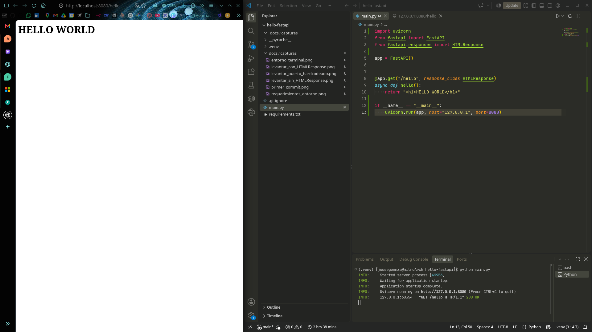
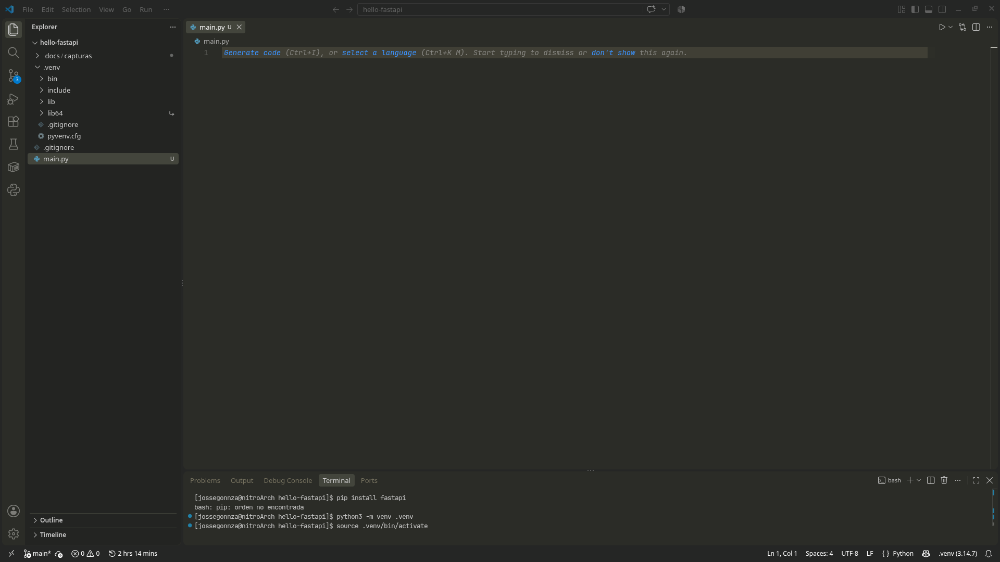
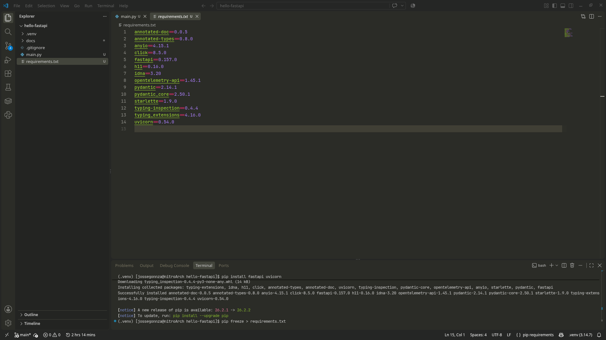
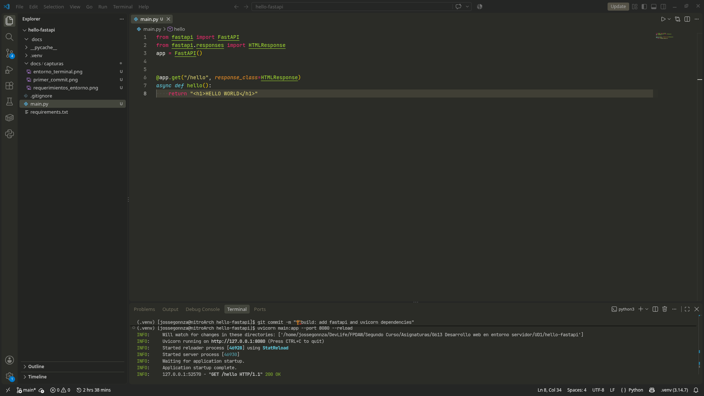
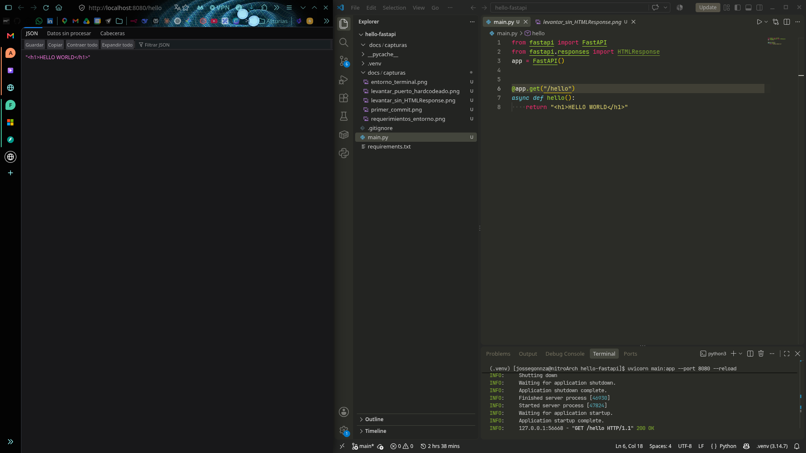
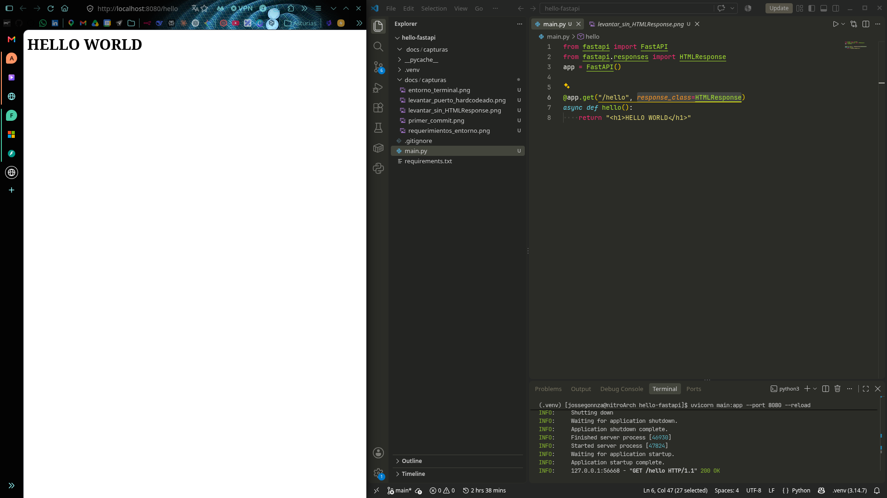

# hello-fastapi

Ejercicio de la Unidad 1 de **0613 · Desarrollo web en entorno servidor** (2º DAW).

Servidor local con FastAPI, sin Docker, que escucha en el puerto **8080** y expone un único endpoint, `/hello`, que devuelve el HTML `<h1>HELLO WORLD</h1>`.



## Cómo ejecutarlo

Desarrollado con Python 3.14, FastAPI 0.157 y uvicorn 0.54.

```bash
python3 -m venv .venv
source .venv/bin/activate
pip install -r requirements.txt
python main.py
```

Con el servidor en marcha, abrir <http://localhost:8080/hello>. FastAPI genera además documentación interactiva en <http://localhost:8080/docs>.

## Estructura

```
hello-fastapi/
├── main.py              Aplicación y arranque del servidor
├── requirements.txt     Dependencias con versión fijada (pip freeze)
├── .gitignore
└── docs/capturas/       Evidencias del proceso
```

## Cómo funciona

Hay dos piezas con responsabilidades distintas:

- **FastAPI** es el framework: define qué rutas existen y qué devuelve cada una.
- **uvicorn** es el servidor: abre el puerto, recibe las peticiones HTTP y se las pasa a FastAPI.

```
Navegador ──GET /hello──▶ uvicorn :8080 ──▶ FastAPI ──▶ hello()
Navegador ◀──────────── text/html ───────────────────── "<h1>HELLO WORLD</h1>"
```

| Código | Para qué |
|---|---|
| `app = FastAPI()` | Crea la aplicación que uvicorn va a servir. |
| `@app.get("/hello", ...)` | Registra la función para las peticiones `GET` a `/hello`. |
| `response_class=HTMLResponse` | Envía la respuesta como `text/html`. Sin esto, FastAPI responde en JSON. |
| `if __name__ == "__main__":` | Arranca el servidor solo al ejecutar el archivo directamente, no al importarlo. |
| `uvicorn.run(app, host="127.0.0.1", port=8080)` | Levanta el servidor en local, en el puerto 8080. |

## Proceso

### 1. Entorno virtual

El sistema no trae `pip` para el Python global (`pip: orden no encontrada`) y no conviene instalar paquetes en él, así que se crea un entorno aislado para el proyecto.



### 2. Dependencias

Instalación de `fastapi` y `uvicorn` y volcado de las versiones exactas a `requirements.txt`, para poder reproducir el entorno sin subir `.venv`.



### 3. Endpoint `/hello`

Primera versión, lanzada desde la terminal con `uvicorn main:app --port 8080 --reload`.



Sin `response_class=HTMLResponse`, FastAPI serializa el texto a JSON y el navegador muestra la cadena literal, con comillas y etiquetas:



Con `HTMLResponse`, la respuesta viaja como `text/html` y el navegador la renderiza:



### 4. Puerto en el código

El arranque pasa a `main.py` con `uvicorn.run(...)`: basta con `python main.py` (o el botón ▶ de VS Code) y el puerto 8080 queda fijado en el propio código. Es la captura del principio.


